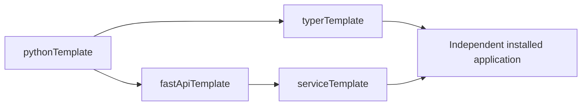

# pythonTemplate

`pythonTemplate` owns the common Python foundation: packaging, quality, tests and engineering conventions. The existing private repository was renamed from `serrja/projectTemplates` without changing its history. Its canonical Copier source is `git@github.com:serrja/pythonTemplate.git`. New CLI applications use [typerTemplate](https://github.com/serrja/typerTemplate); new HTTP applications use [fastApiTemplate](https://github.com/serrja/fastApiTemplate). No Pokerlost SDK, credentials, or hooks are included.

## 🚀 Generate

Requires Python 3.12+, `uv`, and Copier 9.17.2. The stable project answer and CLI can remain camelCase; new import packages are lowercase. Existing answers and published imports require a reviewed migration before renaming.

```bash
destination="$(mktemp -d)"
uvx --from 'copier==9.17.2' copier copy . "$destination" -d projectName=notesLibrary -d profile=library
cd "$destination"
uv lock
uv sync --locked
uv run python -c 'import noteslibrary'
```

The recommended profile here is `library`. Historical `cli` source remains available at full commit `9a4b58e3921b39161bf12f51a98f8b317599ba9c`; its implementation is now owned only by typerTemplate. Use its [reviewed migration path](https://github.com/serrja/typerTemplate/blob/main/docs/migration.md), not an in-place forced copy or edited answers. The `service` and `native` choices reproduce older projects; do not silently regenerate an application under a different profile. The [service migration note](docs/serviceDesign.md) and [naming policy](docs/naming.md) describe the remaining boundaries.

The legacy `service` profile starts without a database. Add `-d withPersistence=true` only for an existing legacy workflow; new web foundations use `fastApiTemplate`. `withTesting=false` and `withCi=false` omit those capabilities from a specialized render.

## 🧭 Ownership

The shared template owns packaging, quality configuration, CI, and the initial documentation structure. The generated project's `PROJECT.md` or `SERVICE.md`, implementation, tests, and lockfile belong to that project. Copier skips its owner document during updates. Review the patch before applying an update; no generated file is an ongoing dependency on this checkout.

## 🛠 Development

From a clean generated Git checkout, use `uvx --from 'copier==9.17.2' copier update --defaults --vcs-ref=<reviewed-template-ref>` and inspect Git conflicts and deletions before accepting the result. Copier writes its own source/ref in `.copier-answers.yml`; do not edit that file to simulate an update. Historical and controlled future updates use real local Git refs in disposable repositories. The source stamp declares unreleased worktree version `0.3.0.dev0` and answers schema 1; removal of the current CLI profile requires the explicit source migration above. No release tag is created here.

The [documentation guide](docs/documentation.md), [contribution guide](docs/contributing.md), [testing guide](docs/testing.md), [naming policy](docs/naming.md), [versioning policy](docs/versioning.md), and [release procedure](docs/releaseGuide.md) each own one topic. The [composition ADR](docs/adr/templateComposition.md) defines pinned derivative sources; the [verification guide](docs/verification.md) records actual checks and limits.

Install the locked maintenance environment with `make install`, then run `make check`. Generated projects provide the same thin Make interface for their applicable commands. Testing-enabled renders have foundation tests and advisory coverage reports; an empty library's import test is not a domain suite.

The [engineering policy](docs/engineering.md) owns tool selection, versions, boundaries and exceptions. The [Markdown contract tool](tools/check_documentation.py) is maintained here as common engineering source; Typer parses its preserved command arguments. Consumers retain checked managed snapshots and provenance; fixes belong here first. Maintenance-only Typer/Pydantic dependencies do not become a library runtime dependency.



This source is private; the linked repositories may require authorization. No
public distribution license has been selected. Generated foundation checks cover
packaging and tooling; application behavior needs project-owned tests.
